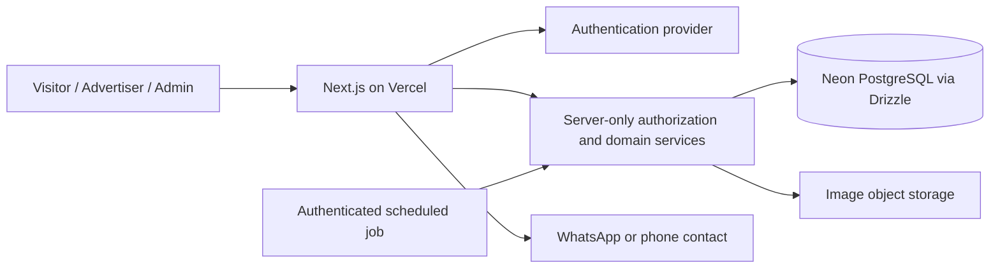

# Project blueprint

Date: 2026-10-21. Status: proposal for owner review. Requirements below are distinguished from recommended implementation choices; unresolved choices are tracked in [DECISIONS.md](DECISIONS.md).

## 1. Product and scope

Students and businesses post products, services and wanted items. Visitors browse, search, share and contact advertisers by WhatsApp or telephone without an account. Registered advertisers manage adverts; administrators moderate and can submit adverts on another person's behalf. No checkout, cart, payment processing or in-app transactions. This project shares no code, database, credentials or deployments with MedNexus.

Initial requirements: all submissions require approval; new advertisers may have five active adverts and submit three new adverts daily; adverts expire after 30 days; administrators configure limits. Duplicate detection, spam protection and reporting are included. Trusted automatic publishing is a later capability, disabled at launch.

## 2. Proposed architecture

Use a single Next.js App Router application with TypeScript and Tailwind CSS. Server components render public content; client components handle interactive search, forms, sharing and image previews. Route handlers expose APIs; shared server-only services enforce authorization and business rules for every entry point. Do not call public APIs over HTTP from server components when the same service can be called directly.

Deploy on Vercel with a free `*.vercel.app` address where eligible. Use Neon PostgreSQL and Drizzle ORM with reviewed SQL migrations. Use a pooled runtime connection and a separate migration connection, both server-only. Explicitly select a Drizzle-compatible transaction-capable Neon driver in Phase 2; posting quota correctness must not depend on unsupported multi-statement HTTP transactions.

Recommend Auth.js with Google sign-in for advertisers and admins, subject to owner approval. Restrict administration through a database role and an explicitly provisioned initial administrator; never promote a user based on a client field or email text alone. Prefer MFA at the admin identity provider. No public admin registration. If password/email login is required, evaluate verification, reset and email-delivery costs before implementation.

Recommend Cloudflare R2 for image object storage, contingent on account, billing requirements and current pricing verification. Keep the storage interface replaceable. Browser uploads use short-lived, scoped signed URLs; the server validates the final object before attaching it to an advert. Store object keys rather than expiring signed URLs. Serve only approved public images through a controlled public delivery path. Staged images must not become publicly listable before moderation.

Use PostgreSQL search and indexes initially; no paid search service, queue or Redis requirement. A scheduled endpoint performs expiry housekeeping, unused-image cleanup and aggregate refresh. Reads independently enforce visibility and expiry, so scheduler delays cannot expose expired adverts. Durable PostgreSQL counters provide low-volume rate limiting across serverless instances.

## 3. Roles and ownership

| Role | Permissions |
| --- | --- |
| Visitor | Read published unexpired adverts and public business profiles; search, share, contact, report with abuse controls |
| Advertiser | Visitor permissions plus manage own drafts, submit revisions, withdraw adverts, mark fulfilled and view moderation feedback |
| Administrator | Review submissions and reports; create on behalf of advertisers; suspend accounts/listings; manage categories, features and limits; inspect audit events |

Separate authenticated users from advertiser profiles. An administrator may create an unclaimed profile with consent and verified seller contact; `created_by` records the admin while `advertiser_id` identifies the actual seller. Never display the admin's contact as the seller. Unclaimed profiles have no login access. Later claiming requires verified contact and an audited administrator-approved transfer, not matching a submitted phone number. Quotas apply to the advertiser even when an admin submits. Any override must be explicit, reasoned and audited.

Business directory profiles and their edits require moderation. A business label does not mean university endorsement or identity verification. University/student eligibility and verification remain owner decisions.

## 4. Proposed data model

Use UUID identifiers, UTC `timestamptz`, foreign keys, required-field constraints and nonnegative price checks. Use integer pesewas for GHS values; never floating point money. Store phone numbers in E.164 format, normalize Ghana numbers with a phone library, and keep WhatsApp and telephone availability explicit.

| Entity | Key data and purpose |
| --- | --- |
| users, auth_accounts, sessions | Identity-provider identifiers, role, suspension, session lifecycle; schema follows selected auth adapter |
| advertisers | Optional unique linked user, student/business type, display name, verification/trust flags, claimed state and suspension |
| business_profiles and revisions | Public directory data, location, contact, approval state; retain approved version during edits |
| categories | Name, slug, active flag, ordering; deactivate used categories rather than deleting references |
| adverts | Advertiser, creator, category, product/service/wanted kind, lifecycle state, approved revision ID, published/expiry timestamps, fulfilled flag |
| advert_revisions | Immutable submitted title, description, price mode/value, condition, location and contact snapshot; draft/pending/approved/rejected state and normalized duplicate fingerprint |
| media_assets, revision_media | Object keys, uploader/advertiser ownership, byte size, detected MIME, checksum, processing state and ordered revision association |
| moderation_events | Actor, action, revision, reason and timestamp; append-only application access |
| reports | Advert, reason, optional detail/contact, deduplication token, triage state and resolution |
| platform_settings | Versioned limits, duration, image constraints and future trusted-publishing toggle; updated by admins only |
| advertiser_daily_usage | Advertiser + Africa/Accra calendar date unique key; accepted submission count |
| rate_limit_buckets | Hashed identity/IP bucket, route purpose, time window, count and expiry |
| audit_events | Administrative role, settings, quota override, ownership and suspension changes; no secrets or raw tokens |
| daily_advert_metrics | Aggregate eligible views/contact clicks for trending; no claim that a click equals a completed sale |
| featured_adverts | Admin-selected advert, order and start/end window; subject to ordinary public visibility rules |

Indexes: public eligibility/expiry/published time; advertiser/state; category and price; pending review time; unique daily usage key; report triage status; revision search vector with GIN index. Use weighted title/description full-text search with prefix handling; evaluate trigram search after measuring relevance and Neon extension availability. Public search indexes only approved text. Never index unapproved revisions into public results.

## 5. Lifecycle and moderation rules

Initial flow: draft → pending review → published or rejected. A published advert may become withdrawn, fulfilled, expired or suspended. Suspension is admin-only; advertisers may withdraw or mark fulfilled. Rejected drafts can be corrected and resubmitted. Moderation decisions include a reason and actor. Use guarded state transitions/version checks to reject stale concurrent moderation actions.

Submitted revisions are immutable. An edit to a live advert creates a pending revision; its last approved revision remains visible until approval, unless withdrawn or suspended. Rejected edits do not alter public content. Owner access and moderation access may view pending material through authenticated routes. Direct advert URLs, home sections, business pages, related adverts and search all use the same public eligibility predicate: published, approved revision exists, not suspended, advertiser allowed, and `expires_at > now()`.

Proposed expiry starts at first publication: 30 days, configurable for future publications. Edits do not reset expiry. Renewal creates a new submission requiring approval and fresh quota checks, and starts a new duration only when approved. Expiry or suspension during edit review prevents that edit from silently republishing the advert. Owner review is required for this interpretation.

Enforce five active adverts per new advertiser. Recommended quota reservation counts unexpired published adverts and pending new adverts/renewals; pending edits reserve no extra slot. This avoids approving more than five from a backlog. Expired, rejected, withdrawn and fulfilled adverts consume no active slot. At approval recheck limits and account state, since settings may have changed.

Daily limit: three accepted new submissions/renewals per Africa/Accra calendar day; failed validation and draft saves do not count. Recommended edits/rejected-revision corrections do not consume new-submission quota but have separate rate limits. Withdrawal/rejection does not refund daily usage. Define this explicitly in UI and API responses.

Submission transaction: authenticate and authorize; validate; lock the advertiser row; read applicable settings; count reserved active slots using database time; lock/upsert daily counter; check idempotency key and duplicates; persist revision/reservation and increment quota atomically. A retry with the same request key returns the original outcome without double counting. Concurrent approvals use the same advertiser lock. Settings changes serialize on their settings record; existing published adverts are not automatically removed when a cap decreases, but new slots are blocked until usage falls below the cap. Tests must cover races across connections.

All new and admin-created submissions require an explicit approval event at launch. An admin can perform both operations if owner policy permits, but creation alone never publishes. Future trust eligibility must remain an independent flag plus global setting; trust must never bypass suspension, validation, expiry or quotas.

Duplicate protection: reject exact normalized repeats by the same advertiser across pending/live adverts, excluding revisions of the same advert; hash normalized title/description/contact/category and compare image checksums. Flag likely matches across different sellers for review rather than automatically rejecting legitimate similar stock. No expensive AI detection initially. Explain duplicate errors and allow admin review with audited overrides.

## 6. Proposed API surface

Version routes under `/api/v1`; use shared Zod validation and consistent errors (`code`, safe `message`, optional field errors, request ID). Return 401/403 for authentication/authorization, 404 for nonpublic resources on public routes, 409 for state/duplicate/quota conflicts, 422 for invalid input and 429 with retry guidance for rate limits. Mutations require server-side authorization; hiding UI controls is insufficient.

| Routes | Purpose |
| --- | --- |
| GET /adverts, /adverts/:id | Public pagination/search/filter/detail over eligible adverts only |
| GET /categories, /businesses, /businesses/:slug, /home | Public categories, approved directory and curated/discovery sections |
| POST /adverts/:id/reports | Anonymous abuse-controlled report; deduplicate repeated reports |
| POST /adverts/:id/events | Bounded anonymous view/contact aggregate collection; never redirects to arbitrary URLs |
| GET /me/adverts; POST /me/adverts | Owner listing and draft creation |
| PATCH /me/adverts/:id | Save draft or create editable revision with ownership checks |
| POST /me/adverts/:id/submit | Submit immutable revision; idempotency and atomic quotas |
| POST /me/adverts/:id/withdraw, /fulfill, /renew | Explicit guarded owner actions |
| POST /uploads/sign, /uploads/complete | Authorize staged upload, then verify object and association |
| GET /admin/submissions, /admin/reports | Moderation queues |
| POST /admin/submissions/:id/approve, /reject | Guarded moderation decision with audit |
| POST /admin/adverts; POST /admin/adverts/:id/suspend | Admin-assisted draft and enforcement actions |
| PATCH /admin/settings, /admin/advertisers/:id | Limits and advertiser status/trust with validation and audit |
| Admin category/business/feature routes | Moderated directory, taxonomy and feature management |
| POST /internal/maintenance | Scheduler-only authenticated, idempotent bounded housekeeping |

Search parameters: bounded text query, category, kind, location, condition, price range, business and sort (fresh, price ascending/descending, trending). Stable cursor pagination uses a tie-breaking advert ID. Cap page size and validate enum values. Prices marked wanted budget, free, negotiable or contact-for-price must have deliberate filter behavior; proposed under-GH₵100 section includes only offered items/services with known price strictly below 10,000 pesewas.

## 7. Public and dashboard UX

Mobile bottom navigation: Home, Explore, Post, Businesses, My Adverts. Post and My Adverts request login only when needed. Desktop top navigation and responsive grids. Preserve search/filter URL parameters and return location across login. Forms have clear quota/expiry guidance, image upload progress, draft saving, contact consent and pending-review feedback.

Home includes categories, Fresh Finds (publication descending), Trending on Campus (recent eligible aggregate views/contact clicks with bounded abuse-resistant weighting), Deals Under GH₵100, and admin-selected featured adverts. Empty sections should show useful empty states, never fabricated listings or rankings. Start trending with recent listings until enough observations exist and label that fallback accurately.

Advert details show photos, title, price or budget, type, category, seller, campus area, publication/expiry context, share and report actions. WhatsApp opens `wa.me` with a validated normalized number and URL-encoded advert title/canonical link. Phone uses `tel:`. Use Web Share API with copy-link fallback. Only approved consented contact details become public. Clearly explain that contact details are public and interactions occur directly with the advertiser.

Advertiser dashboard shows draft/pending/published/rejected/expired/fulfilled adverts, rejection reasons, remaining quotas and edit/renew/withdraw actions. Admin dashboard includes submission previews and history, reports, assisted posting, settings, features and suspension controls. Moderate business profiles as well as adverts.

Accessibility target: WCAG 2.2 AA; keyboard access, visible focus, labels, contrast, alt text, screen reader announcements and usable touch targets. Reserve space for mobile navigation/safe areas. Compress images and use responsive sizes, lazy loading and pagination for mobile data budgets. Test at phone, tablet and desktop widths. Use canonical URLs and metadata for public adverts; prevent indexing of private dashboards and drafts.

## 8. Security, abuse and operations

Validate on the server, enforce ownership on every record lookup, use secure HTTP-only cookies, origin/CSRF protection for cookie-authenticated mutations and parameterized queries. Escape text; no arbitrary advert HTML. Bound body sizes and search complexity. Rate-limit login, submissions, reports, uploads and event collection with durable buckets; introduce a free-tier challenge service for suspicious anonymous activity if needed. Hash short-lived IP identifiers with a server secret and establish retention before launch.

Proposed image defaults: up to five images per advert, five MB each, JPEG/PNG/WebP inputs. Validate magic bytes and actual dimensions, reject SVG/active content and decompression bombs, re-encode/strip metadata, enforce storage ownership, clean abandoned uploads and only expose approved derivatives. MIME headers alone are insufficient. Enforce budgets server-side; client resizing only improves experience. Decide processing runtime limits during Phase 2 design validation.

Keep all secrets out of Git, browser bundles, logs and screenshots. `DATABASE_URL`, migration URL, auth secret, identity-provider secret, storage credentials and scheduler secret are server-only; never prefix them with `NEXT_PUBLIC_`. Commit only placeholder variable names in a later `.env.example`. Use distinct development, preview and production credentials/databases/buckets. Preview deployments must never mutate production. Protect admin and private responses from shared caches; invalidate public caches after moderation and enforce expiry at the final response boundary.

Log request IDs and safe operational events. Audit sensitive changes, protect logs from ordinary users and define retention/deletion rules before launch. Reports do not automatically hide listings based solely on volume. Avoid storing raw contact-click identities. Suspend advertisers without deleting evidence; remove public visibility immediately. Define privacy notice, terms, prohibited goods and takedown process with the owner, including restrictions on medicines, prescriptions, patient information and university branding. No clinical/patient data belongs in this service.

## 9. Cost and deployment design

Use free tiers where suitable, but do not promise zero ongoing cost. Verify current Vercel commercial-use eligibility, Neon storage/compute limits, storage egress/operations, billing requirements, scheduled job frequency and identity/email costs before selecting accounts. If a paid plan is required for business advertising, present its cost before provisioning. Images and bot traffic are primary cost risks: enforce quotas, cap transformations, set available budget alerts and monitor usage.

Phase 5 will document environment-variable names, account ownership, GitHub/Vercel integration, Neon setup, region selection close to likely users and database, migrations, image delivery, scheduled job setup, TLS, production seed categories, admin bootstrap, rollback and recovery. Apply migrations in a controlled release job, never on every serverless request or competing preview build. Prefer backward-compatible schema changes; recovery requires verified backups/export availability and a restore rehearsal, not just a Git revert.

## 10. Acceptance and verification plan

Phase 2 must verify service rules using unit tests and integration tests against an isolated real PostgreSQL database, including transaction races. Cover unauthenticated access, cross-owner access, admin role checks, pending leakage, edit approval, duplicate checks, fourth daily submission, sixth reserved slot, retries, concurrent submissions/approvals, account suspension, settings changes and Ghana day/30-day expiry boundaries. Check SQL migrations from an empty database and a representative prior schema.

Phase 3 verifies responsive layouts, keyboard navigation and meaningful empty/loading/error states. Phase 4 exercises submit → approve → browse/search → WhatsApp/phone target, plus rejection, reporting, business directory and expiry. Assert generated contact URLs without sending messages or calling people. Phase 5 verifies preview isolation, secret handling, migration release procedure, scheduler authentication, recovery and production smoke checks.

No tests have been run or claimed for an application: Phase 1 creates planning documents only. Later reports must distinguish executed checks, failures, skipped checks and manual observations.
